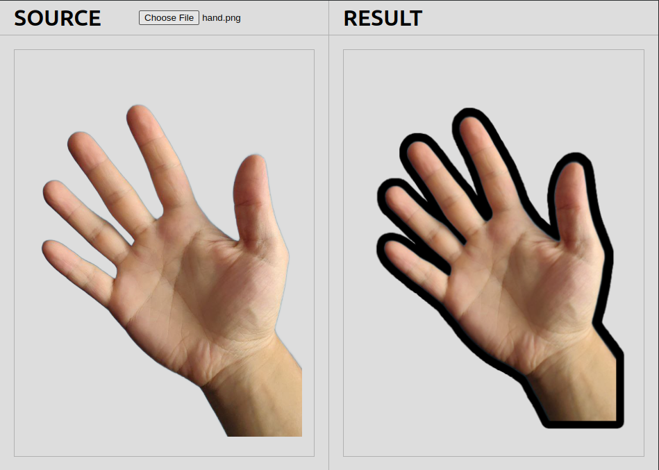
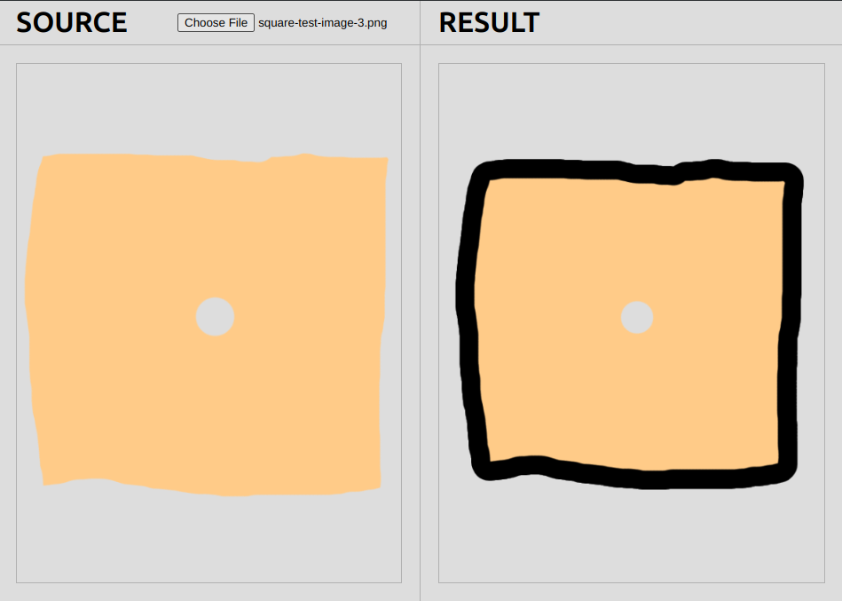
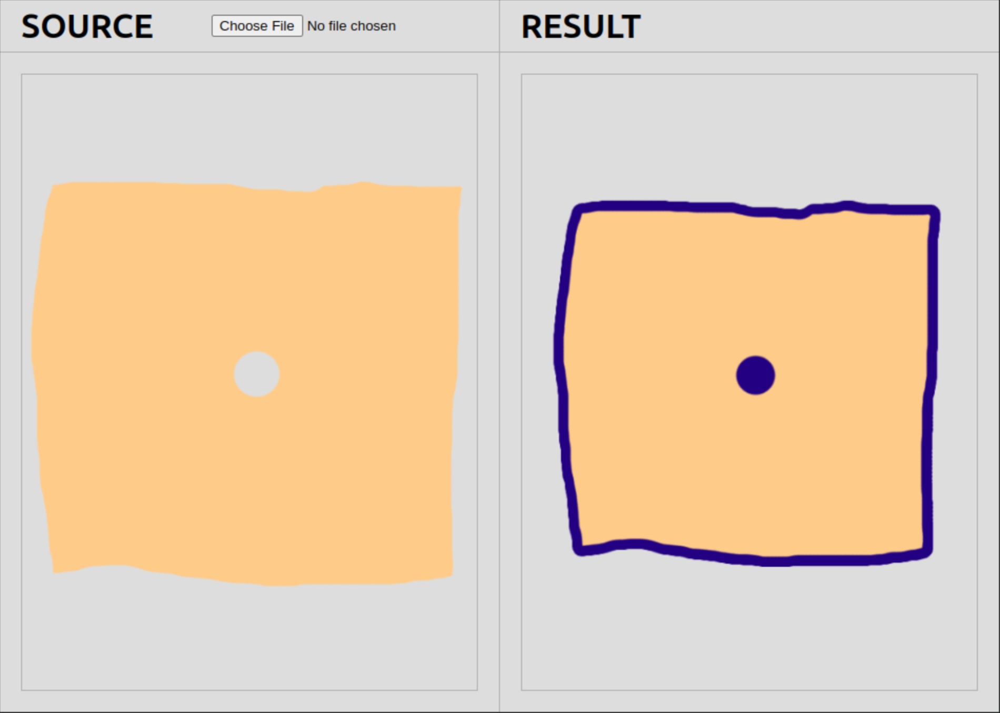
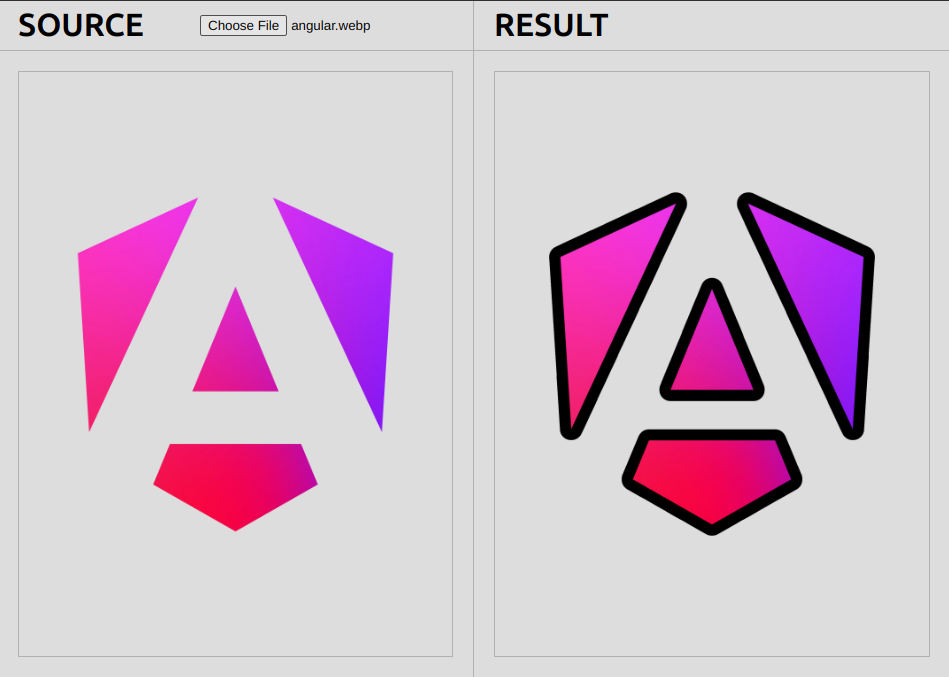
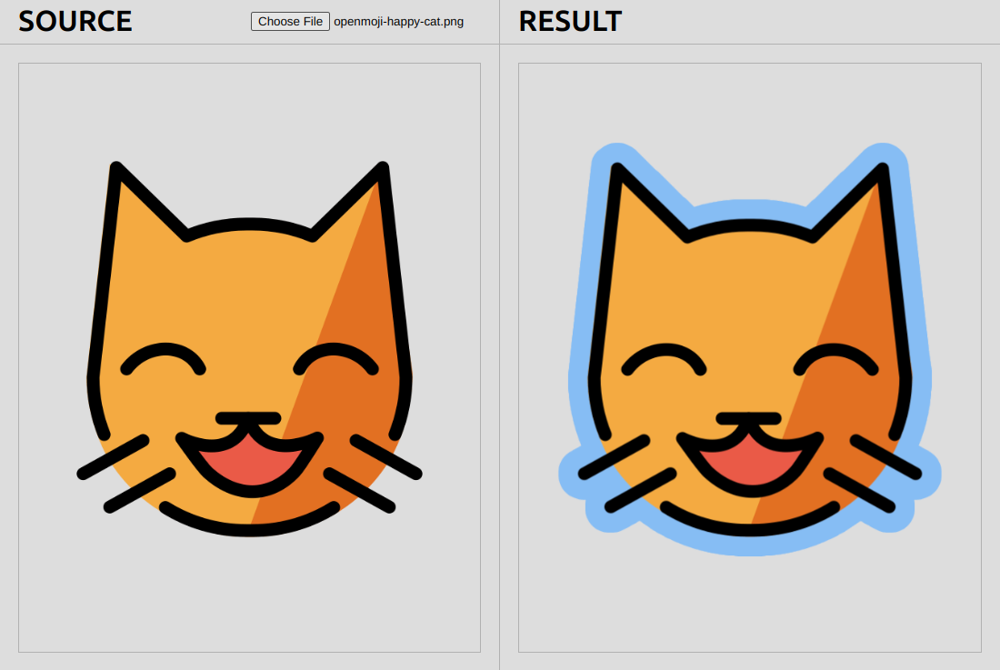
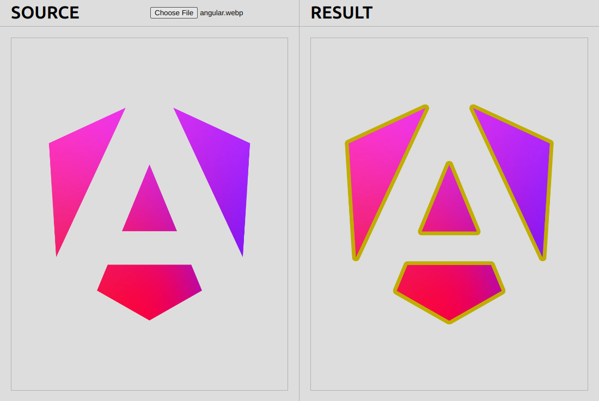
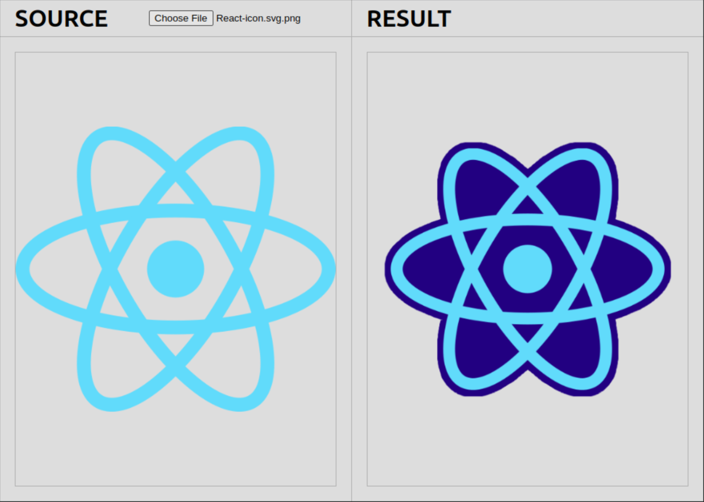

# @devadri/create-sticker

**Library that adds a sticker effect to images with transparent backgrounds.**

**[Try the live demo](https://adrian-bueno.github.io/create-sticker/)**


> This code was made thanks to [this Stack Overflow answer](https://stackoverflow.com/a/24091727) made by the user [markE](https://stackoverflow.com/users/411591/marke).

Tested with `.png`, `.webp` and `.jpg`.

It uses HTML Canvas, so it only works in the browser (and not in Node.js).


## Install

### Browser

```html
<script src="https://unpkg.com/@devadri/create-sticker@1/bundle.iife.js"></script>
```

### npm

```sh
npm install @devadri/create-sticker
```

## Usage

### Browser

```html
<script src="https://unpkg.com/@devadri/create-sticker@1/bundle.iife.js"></script>
<script>
  async function modifyImage(img) {
    const options = {
      strokeWidth: 20,
      strokeColor: "black",
      fillHoles: true
    }
    const stickerImgSrc = await CreateSticker.createSticker(img.src, options);
    img.src = stickerImgSrc;
  }
</script>
```

### ESM / TypeScript

```ts
import { createSticker, CreateStickerOptions } from '@devadri/create-sticker';

async function modifyImage(img) {
  const options: CreateStickerOptions = {
    strokeWidth: 20,
    strokeColor: "black",
    fillHoles: true
  }
  const stickerImgSrc = await createSticker(img.src, options);
  img.src = stickerImgSrc;
}
```

## API

| Function | Returns |
|---|---|
| `createSticker(image, options?)` | `Promise<string>`: data URL |
| `createStickerBlob(image, options?)` | `Promise<Blob>` |
| `createStickerCanvas(image, options?)` | `Promise<HTMLCanvasElement>` |

`image` can be an image URL, a `Blob`/`File`, an `HTMLImageElement`, an `HTMLCanvasElement`, an `OffscreenCanvas` or an `ImageBitmap`.

### Options

All options are optional.

| Option | Default | Description |
|---|---|---|
| `strokeWidth` | `20` | Stroke width in pixels. |
| `strokeColor` | `"white"` | Stroke color (any CSS color). |
| `fillHoles` | `true` | Fill transparent holes with the stroke color. |
| `strokeHoles` | `false` | When `fillHoles` is `false`, also add the stroke around holes. |
| `outlines` | `[]` | Extra outlines around the stroke, e.g. `[{ width: 3, color: "#999" }]`. |
| `shadow` | `false` | Drop shadow. `true` or `{ color, blur, offsetX, offsetY }`. |
| `padding` | `strokeWidth / 2` | Transparent space added around the image, in pixels. |
| `trim` | `false` | Crop the result to its visible content. |
| `maxSize` | none | Scale down images larger than this (in pixels) before processing. |
| `alphaThreshold` | `0` | Ignore pixels with alpha (0-255) at or below this value when finding outlines. |
| `crossOrigin` | `"anonymous"` | CORS mode for image URLs. Remote images must allow CORS. |
| `outputType` | `"image/png"` | Output format, e.g. `"image/webp"`. |
| `outputQuality` | `1` | Quality (0 to 1) for lossy formats. |


## Screenshots










## License

[Unlicense license](./LICENSE.md)
